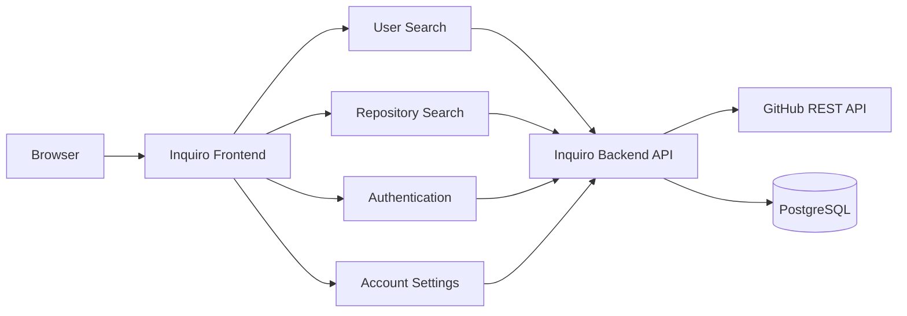

<p align="center">
  
</p>

<h1 align="center">Inquiro</h1>

<p align="center">
  A responsive web application for discovering GitHub users and repositories through a dedicated search interface.
</p>

<p align="center">
  <strong>HTML5 · SCSS · CSS3 · JavaScript · REST API · Vercel</strong>
</p>

<p align="center">
  <a href="https://github-search-fontend-b806za0at-samuelfdezs-projects.vercel.app/">Live Demo</a>
  ·
  <a href="https://github.com/SamuelFDEZS/githubSearch-backend">Backend API</a>
</p>

---

## Overview

**Inquiro** is a frontend application built to make exploring GitHub users and repositories more direct and visual.

Instead of exposing raw API responses, the application transforms GitHub data into dedicated search experiences with dynamic cards, detailed popups, pagination, repository filters and user-oriented navigation.

The project was built without a frontend framework, using **vanilla JavaScript and direct DOM manipulation**, with the interface styled through a modular SCSS structure and adapted across desktop, tablet and mobile layouts.

Inquiro is connected to a separate Node.js backend responsible for GitHub API communication, authentication and user persistence.

---

## Main features

### GitHub user search

Users can search GitHub accounts by username and browse the results through dynamically generated profile cards.

Each result includes additional information such as:

* Username and avatar.
* Followers.
* Public repositories.
* Recent event count.
* Subscription information.

Selecting a user opens a detailed modal where additional profile information can be inspected without leaving the search page.

From there, users can:

* Open the original GitHub profile.
* Browse repositories belonging to that user.
* Continue exploring results without losing the search context.

Search results also support pagination.

---

### Repository search

Repository discovery provides two different search modes.

#### Approximate search

Searches GitHub repositories using free-text input and optional filters.

#### Precise search

Allows a repository to be requested directly using its owner and repository name.

Repository results are displayed as interactive cards containing information such as:

* Repository owner.
* Main language.
* Creation age.
* Visibility.
* Download availability.
* Homepage availability.

Selecting a repository opens a detailed modal containing:

* Stars.
* Forks.
* Main language.
* Subscribers.
* Last update.
* Open issues.
* License.
* Default branch.
* Direct repository link.
* Homepage link when available.

---

## Repository filters

Approximate repository searches can be refined through several filters.

| Filter   | Available options                                                                                         |
| -------- | --------------------------------------------------------------------------------------------------------- |
| Language | JavaScript, TypeScript, Python, Java, C#, C++, Go, Rust, PHP, Ruby, Swift, Kotlin, Dart, HTML, CSS, Shell |
| Stars    | Star-based filtering                                                                                      |
| Date     | Last week, month, 3 months, 6 months, year, 2 years or 5 years                                            |
| Topic    | React, Vue, Angular, Node.js, Express, TypeScript, Docker, API, frontend, backend, AI and others          |
| License  | MIT, GPLv3, Apache 2.0, BSD 3-Clause, MPL 2.0 and Unlicense                                               |
| Sort     | Best match, stars, forks or last update                                                                   |
| Order    | Ascending or descending                                                                                   |

Filters are converted into URL search parameters and sent to the backend, which translates them into GitHub repository-search qualifiers.

---

## Authentication

Inquiro also includes its own application account system, independent from GitHub accounts.

Users can:

* Create an account.
* Log in.
* Keep the session between browser visits.
* Use a temporary session instead.
* Log out.
* Access protected areas of the interface.
* Edit account information.
* Change their password.

Authentication is handled by the backend using JWTs.

After login, the frontend stores the returned token and user information using either:

```text
localStorage
```

or:

```text
sessionStorage
```

depending on whether the user chooses to keep the session active.

This allows the interface to react to the current authentication state by changing navigation options and restricting access to authenticated functionality.

---

## Account configuration

Authenticated users have access to a dedicated profile configuration screen.

The interface allows them to manage:

* Username.
* Email address.
* Phone number.
* Password.

Password changes are handled through a separate modal requiring the current password, the new password and confirmation.

The configuration screen also provides feedback for successful and failed operations and allows changes to be discarded before submission.

---

## Responsive interface

The interface was designed manually for different screen sizes rather than relying on a UI framework.

The SCSS contains dedicated responsive behavior for:

* Large desktop screens.
* Standard desktop layouts.
* Tablets.
* Small tablets.
* Mobile devices.
* Very small mobile screens.

Layouts adapt their dimensions, typography, alignment and positioning according to the available viewport.

On smaller screens, the desktop navigation is replaced by a burger-menu interaction.

Search cards, filters, home sections, account screens, modals and footer elements also adapt to reduced widths.

---

## Frontend architecture



The frontend is intentionally separated from the backend.

The browser is responsible for:

* Rendering the interface.
* Managing interactions.
* Validating search input.
* Building query parameters.
* Maintaining client-side session state.
* Rendering API responses.

The backend is responsible for:

* GitHub API access.
* Keeping GitHub credentials outside the browser.
* Authentication.
* JWT validation.
* User persistence.
* Database access.

---

## Project structure

```text
.
├── assets/
│   ├── fonts/
│   └── images/
│
├── js/
│   ├── config/
│   │   └── api.js
│   │
│   ├── filters/
│   │   ├── filters.js
│   │   └── renderFilters.js
│   │
│   ├── burgerMenu.js
│   ├── configurations.js
│   ├── currentUser.js
│   ├── home.js
│   ├── login.js
│   ├── repoSearch.js
│   ├── search.js
│   ├── signup.js
│   ├── userRepos.js
│   └── userSearch.js
│
├── pages/
│   ├── help/
│   │   ├── help-config.html
│   │   ├── help-home.html
│   │   ├── help-login.html
│   │   ├── help-logout.html
│   │   ├── help-register.html
│   │   ├── help-repos.html
│   │   └── help-users.html
│   │
│   ├── configurations.html
│   ├── help.html
│   ├── login.html
│   ├── repoSearch.html
│   ├── signup.html
│   ├── userRepos.html
│   └── userSearch.html
│
├── styles/
│   ├── base/
│   │   ├── _html.scss
│   │   ├── _mixin.scss
│   │   ├── _reset.scss
│   │   ├── _variables.scss
│   │   ├── main.scss
│   │   └── main.css
│   │
│   ├── components/
│   │   ├── common/
│   │   ├── configurations/
│   │   ├── help/
│   │   ├── home/
│   │   ├── login/
│   │   ├── logout/
│   │   ├── repoSearch/
│   │   ├── signup/
│   │   ├── userRepos/
│   │   └── userSearch/
│   │
│   ├── pages/
│   └── utils/
│
├── index.html
├── package.json
└── README.md
```

---

## Styling approach

Styles are written in **SCSS** and divided by responsibility instead of maintaining a single stylesheet.

The main SCSS entry point combines:

```text
Base
├── reset
├── variables
├── mixins
└── global HTML styles

Utilities
├── fonts
└── loaders

Components
├── header / footer
├── authentication
├── user search
├── repository search
├── repository details
├── account configuration
├── help
└── common UI elements
```

The compiled stylesheet is stored in:

```text
styles/base/main.css
```

Class names generally follow a **BEM-inspired naming convention**, making the relationship between components and their child elements explicit.

Example:

```text
.reposearch-results__card
.reposearch-results__card__image
.reposearch-results__card__info-container
```

---

## Dynamic UI

Much of the interface is generated and updated directly through JavaScript rather than being statically defined in HTML.

This includes:

* User result cards.
* Repository result cards.
* User detail popups.
* Repository detail popups.
* Password-change dialogs.
* Logout confirmation dialogs.
* Loading indicators.
* Search errors.
* Pagination controls.
* Authentication-aware navigation.

The project therefore contains significant DOM manipulation and event-driven UI logic despite not using a JavaScript framework.

---

## Search validation

Search inputs are validated before requests are sent.

Usernames follow GitHub-compatible character rules and repository input is checked against the expected repository naming format.

Invalid input is surfaced directly in the interface instead of generating unnecessary API requests.

Both search experiences can also be triggered through the keyboard using the Enter key.

---

## Pagination

Both user and repository searches support pagination.

The frontend reads pagination information returned by the API and dynamically enables or disables navigation controls according to whether another page is available.

Changing pages:

1. Updates the current page state.
2. Requests the corresponding result set.
3. Updates pagination controls.
4. Returns the viewport to the beginning of the results.

---

## Loading and error states

Asynchronous actions include visual feedback rather than leaving the interface unchanged while data is being requested.

The application handles states including:

* Loading results.
* Invalid search input.
* Empty searches.
* User not found.
* API request failures.
* Authentication failures.
* Registration errors.
* Account update errors.
* Successful account operations.

---

## Help section

Inquiro includes a dedicated help area covering the main parts of the application.

Documentation pages are available for:

* Home.
* Login.
* Registration.
* Logout.
* User search.
* Repository search.
* Configuration.

This keeps usage guidance inside the application instead of relying exclusively on external documentation.

---

## Backend integration

The main API URL is centralized in:

```text
js/config/api.js
```

For example:

```js
const API_URL = 'https://your-backend.vercel.app';

export default API_URL;
```

Frontend modules can import this value when communicating with the API:

```js
import API_URL from './config/api.js';
```

The backend is maintained in a separate repository:

**GitHub Search Backend**
https://github.com/SamuelFDEZS/githubSearch-backend

It provides:

* GitHub API integration.
* Repository filtering.
* User registration and login.
* JWT authentication.
* PostgreSQL persistence.
* Account management.
* Automated tests.
* Docker support.
* CI/CD.

---

## Running locally

The frontend does not require a JavaScript framework or a runtime build step to start.

### Requirements

A modern browser and a local static web server.

Clone the repository:

```bash
git clone https://github.com/SamuelFDEZS/githubSearch.git
cd githubSearch
```

Make sure the API URL inside:

```text
js/config/api.js
```

points to either the deployed backend or your local backend instance.

For local backend development, for example:

```js
const API_URL = 'http://localhost:3000';
```

Then serve the project through a local web server and open `index.html`.

Using a web server instead of opening the file directly is recommended because the frontend uses JavaScript ES modules.

---

## User flow

A typical application flow looks like this:

```text
Landing page
     ↓
Register / Login
     ↓
Authenticated session
     ↓
┌─────────────────────────┐
│                         │
↓                         ↓
Search users         Search repositories
↓                         ↓
User cards            Filtered repo cards
↓                         ↓
User details           Repository details
↓
User repositories

          ↓

Account configuration
```

---

## Technical decisions

### Vanilla JavaScript

The application was intentionally implemented without a frontend framework.

This required handling DOM creation, event listeners, UI state, asynchronous requests and component-like interactions directly in JavaScript.

### Separate frontend and backend

The user interface and server API live in independent repositories and deployments.

This keeps presentation concerns separate from authentication, database access and external API credentials.

### Client-side session persistence

`localStorage` and `sessionStorage` are used differently depending on whether the user wants the login to persist after the browser session.

### Server-side GitHub credentials

GitHub credentials are kept in the backend rather than being included in frontend source code.

### Component-oriented SCSS

Styles are split into small files based on page and component responsibility and compiled into a shared stylesheet.

### Responsive design without a component library

Responsive behavior was implemented directly using SCSS and media queries rather than Bootstrap, Tailwind or another UI framework.

---

## Current scope and possible improvements

Inquiro already covers its original search and account-management goals, but there are several directions in which the frontend could evolve:

* Add automated frontend tests.
* Improve accessibility and keyboard navigation.
* Centralize every API request through a dedicated service layer.
* Improve token lifecycle and expired-session handling.
* Add GitHub OAuth.
* Add saved or favorite searches.
* Add repository/user favorites.
* Improve empty, error and loading states.
* Add richer search filters.
* Introduce reusable Web Components or migrate selected UI areas to React.
* Add frontend CI checks for linting and tests.
* Continue improving performance and accessibility across mobile devices.

---

## Related repository

The server-side application is maintained separately:

**GitHub Search Backend**
https://github.com/SamuelFDEZS/githubSearch-backend

The backend handles the GitHub REST API integration, PostgreSQL persistence, authentication and deployment pipeline used by this frontend.

---

## Author

**Samuel Fernández**

GitHub:
https://github.com/SamuelFDEZS
